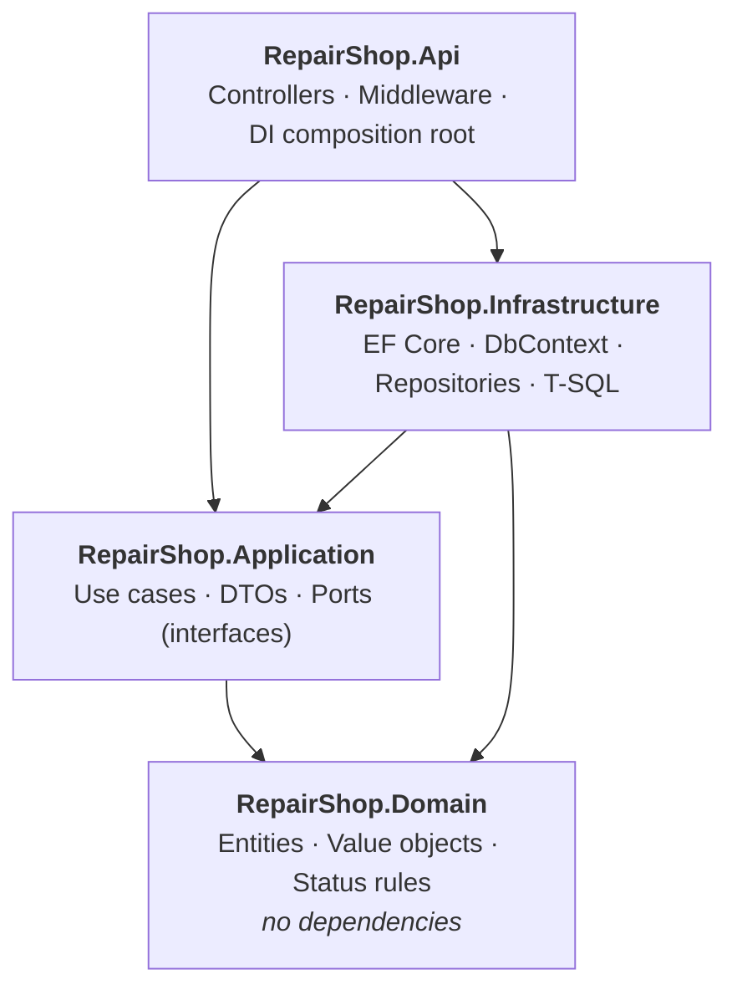
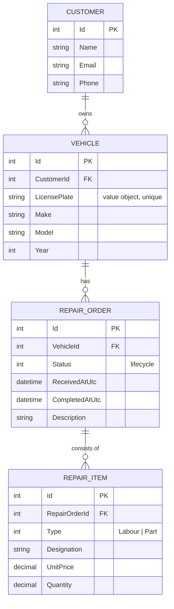
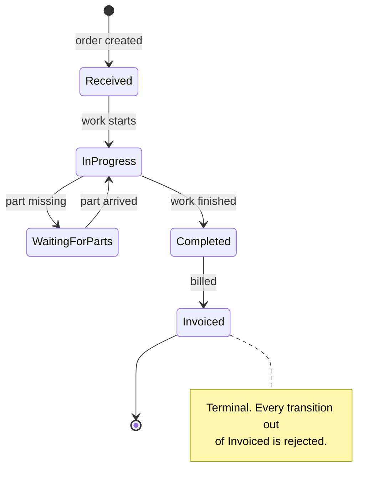

# repair-shop-api

[](https://github.com/M1ka3il/repair-shop-manager/actions/workflows/ci.yml)
[](https://dotnet.microsoft.com/)
[](LICENSE)

Management of car repair orders as a REST API: customers own vehicles, vehicles have
repair orders, repair orders carry labour and parts lines. The order lifecycle
(*accepted → in progress → waiting for parts → finished → invoiced*) is enforced in the
domain layer, so an invoiced job cannot be pushed back into production — the caller gets
a business error, not a 500.

Clone it, run `docker compose up`, open <http://localhost:8080>. Nothing else to install.

---

## Table of contents

- [Quick start](#quick-start)
- [Architecture](#architecture)
- [Domain model](#domain-model)
- [The status flow](#the-status-flow)
- [API](#api)
- [Design decisions](#design-decisions)
- [What was deliberately left out](#what-was-deliberately-left-out)
- [Testing](#testing)
- [Local development without Docker](#local-development-without-docker)
- [Project layout](#project-layout)

---

## Quick start

Requirements: Docker (with Compose). No .NET SDK, no SQL Server installation.

```bash
git clone https://github.com/M1ka3il/repair-shop-manager.git
cd repair-shop-manager

cp .env.example .env      # then edit .env and set your own password
docker compose up --build
```

Then open <http://localhost:8080> — Swagger UI is served at the root. The database
schema is created by EF Core migrations on startup and seeded with a handful of
customers, vehicles and orders in different statuses, so the first request already
returns something meaningful.

> **On the password:** it lives in `.env`, which is gitignored. `.env.example` shows
> the shape without the value. A committed database password in an application repo
> undermines exactly the credibility the repo is meant to demonstrate.

Health check: `GET /health`.

---

## Architecture

Clean Architecture with four projects. **Dependencies point inwards only** — the
domain knows nothing about the database, and the API knows nothing about EF Core
beyond registering it.



| Project | Contains | Depends on |
|---|---|---|
| `Domain` | Entities, value objects (`LicensePlate`), status logic, `DomainException` | *nothing* |
| `Application` | Use cases, DTOs, repository and reporting interfaces | Domain |
| `Infrastructure` | `DbContext`, EF configurations, migrations, repository implementations, stored-procedure caller | Application, Domain |
| `Api` | Controllers, exception middleware, Swagger, DI wiring | Application, Infrastructure |

`Infrastructure` implements interfaces that `Application` declares. That inversion is
the point: the use cases depend on `IRepairOrderRepository`, not on EF Core, and the
whole persistence layer could be swapped without touching a single use case.

Each layer exposes exactly one `AddXxx()` extension method, so `Program.cs` reads as a
list of layers rather than a list of services.

---

## Domain model

Four entities in one clean chain — enough for real domain logic, small enough to stay
readable.



`RepairOrder` is the aggregate root: line items are only ever added or removed through
it, and `TotalPrice` is computed from the items rather than stored, so it cannot drift
out of sync.

---

## The status flow

This is the business core of the project.



The transition table lives in `RepairOrder` — [`src/RepairShop.Domain/Entities/RepairOrder.cs`](src/RepairShop.Domain/Entities/RepairOrder.cs) —
as a single dictionary, not scattered across `if` statements in a controller:

```csharp
[RepairOrderStatus.Received]        = [RepairOrderStatus.InProgress],
[RepairOrderStatus.InProgress]      = [RepairOrderStatus.WaitingForParts, RepairOrderStatus.Completed],
[RepairOrderStatus.WaitingForParts] = [RepairOrderStatus.InProgress],
[RepairOrderStatus.Completed]       = [RepairOrderStatus.Invoiced],
[RepairOrderStatus.Invoiced]        = []
```

An attempt to move an invoiced order back to *in progress* raises a `DomainException`,
which the central middleware turns into a **400 Bad Request** with a problem detail
naming the rule — never a 500:

```json
{
  "title": "Business rule violated",
  "status": 400,
  "detail": "Cannot change status from 'Invoiced' to 'InProgress'. Allowed from 'Invoiced': nothing (terminal status).",
  "instance": "/api/repair-orders/5/status",
  "traceId": "0HN7GK4L2P3QR:00000001"
}
```

Related rules that live in the same place: line items cannot be added to or removed
from a completed or invoiced order, and an invoiced order's description is frozen.

---

## API

Swagger UI at <http://localhost:8080>, OpenAPI document at `/swagger/v1/swagger.json`.

| Method | Route | Purpose |
|---|---|---|
| `GET` | `/api/repair-orders?status=` | List orders, newest first, optional status filter |
| `GET` | `/api/repair-orders/{id}` | One order including its line items |
| `POST` | `/api/repair-orders` | Create an order (**201** + `Location` header) |
| `PUT` | `/api/repair-orders/{id}` | Edit the description |
| `DELETE` | `/api/repair-orders/{id}` | Delete an order (**204**) |
| `PATCH` | `/api/repair-orders/{id}/status` | **Change status** — the dedicated lifecycle endpoint |
| `POST` | `/api/repair-orders/{id}/items` | Book labour or a part |
| `DELETE` | `/api/repair-orders/{id}/items/{itemId}` | Remove a line item |
| `GET` | `/api/customers`, `/api/customers/{id}` | Customers incl. their vehicles (read-only) |
| `GET` | `/api/vehicles` | All vehicles — useful for picking a `vehicleId` |
| `GET` | `/api/reports/revenue-by-customer?from=&to=` | Revenue report (stored procedure) |
| `GET` | `/health` | Liveness probe |

Status codes are used deliberately: **201** on create with a `Location` header, **204**
on delete, **400** on a rejected business rule or failed validation, **404** for a
missing resource, **500** only for genuine defects.

> **Screenshot placeholder:** add `docs/swagger.png` and reference it here once the
> stack has been started once — `docker compose up`, then screenshot
> <http://localhost:8080>. It is the visual anchor a backend-only repo otherwise lacks.

### Example: walking an order through its lifecycle

```bash
# Create
curl -X POST http://localhost:8080/api/repair-orders \
  -H "Content-Type: application/json" \
  -d '{"vehicleId": 1, "description": "Kupplung rutscht bei Volllast"}'

# Book labour
curl -X POST http://localhost:8080/api/repair-orders/7/items \
  -H "Content-Type: application/json" \
  -d '{"type": "Labour", "designation": "Kupplung wechseln", "unitPrice": 89.00, "quantity": 6}'

# Start work
curl -X PATCH http://localhost:8080/api/repair-orders/7/status \
  -H "Content-Type: application/json" \
  -d '{"targetStatus": "InProgress"}'

# Illegal jump — answered with 400, not 500
curl -X PATCH http://localhost:8080/api/repair-orders/7/status \
  -H "Content-Type: application/json" \
  -d '{"targetStatus": "Invoiced"}'
```

---

## Design decisions

### Clean Architecture for four entities?

Strictly speaking unnecessary — but it makes the dependency direction *checkable*:
`RepairShop.Domain.csproj` has no `PackageReference` at all, so a database concern
cannot structurally leak into the business rules. The cost is honest: more projects,
more DI wiring, one extra mapping step. Worth it because this domain has real rules;
for a pure CRUD forwarder it would not be.

### A dedicated status endpoint instead of `PUT`?

A status is not an editable attribute but a *transition* that either is or is not
allowed. A generic `PUT` with a `status` field would let a client set any value and
force the server to retro-validate it. `PATCH /{id}/status` maps directly onto
`RepairOrder.TransitionTo()` and keeps the audit log meaningful.

### A stored procedure for the revenue report?

The report aggregates across all four tables and pivots labour against parts in one
pass — in LINQ a group-join with two conditional sums, neither readable nor tunable,
returning a report row that is not an aggregate. As `dbo.usp_GetRevenueByCustomer` it
is reviewable as SQL, has a stable plan, and ships in a
[migration](src/RepairShop.Infrastructure/Persistence/Migrations/20260718191028_AddRevenueByCustomerProcedure.cs)
rather than being applied by hand. The deliberate exception, not the house style: raw
SQL for reporting, EF Core for the write model.

### DTOs instead of entities?

The entities are encapsulated — private setters, private constructors — so serialising
them out and binding them back in would open exactly the doors that keep the status
rules enforceable. It also decouples the public contract from the schema, and avoids
navigation properties serialising into cycles or a data leak. Mapping is hand-written:
with four entities that is shorter than the AutoMapper configuration it would replace.

### `LicensePlate` as a value object?

A plate has no identity — it *is* its value — and it has a format that can be wrong. As
a `record` with a private constructor and a `Create` factory, a malformed plate cannot
exist in the domain at all; validation happens once at the boundary instead of in every
controller. EF Core stores it as a uniquely indexed column via a value conversion.

### Error handling in middleware?

One place decides how exceptions become HTTP responses, so no controller carries a
try/catch. `DomainException` → **400** with the rule's own message (the system is
working; the caller asked for something the business forbids), `NotFoundException` →
**404**, everything else → **500** with detail in the log only. Every response carries a
`traceId` linking a client-visible error to its log line.

### Migrations at startup?

It makes `docker compose up` a single command, which is the entire promise of this repo.
With several instances this would race, so a real deployment moves migrations into a
separate step — the trade-off is stated in the code and switchable via
`Database:AutoMigrate`.

### No frontend?

This is a backend service and is scoped as one; Swagger is the interface. Angular would
double the effort and shift the centre of gravity away from what the repo is meant to
show — domain logic, layering, operational maturity. It is on the "possible later" list,
not the "missing" list.

---

## What was deliberately left out

Scope control is a design decision, so the omissions are listed rather than hidden:

| Left out | Why |
|---|---|
| Employee management, scheduling | Adds tables and CRUD, adds no new domain logic |
| Inventory / stock | A domain in its own right; would dwarf the repair order |
| Invoice generation (PDF, tax) | Tax law is a rabbit hole; `Invoiced` as a status is the interesting part |
| Authentication (JWT) | Would be the right next step for production, but adds no domain depth |
| Customer/vehicle write endpoints | Read-only is enough to exercise the repair-order flow; full master-data CRUD is volume, not signal |
| Pagination, sorting, filtering beyond status | Straightforward to add, nothing to demonstrate |

---

## Testing

```bash
dotnet test
```

| Project | Kind | Covers |
|---|---|---|
| `RepairShop.Domain.Tests` | Unit (NUnit) | Status transitions, item rules, `LicensePlate` — no database |
| `RepairShop.Application.Tests` | Unit (NUnit + Moq) | Use-case orchestration with mocked repositories |
| `RepairShop.IntegrationTests` | Integration (Testcontainers) | Endpoints end-to-end against a real SQL Server |

The emphasis is the status flow: every legal transition, every illegal one, and the
terminal behaviour of `Invoiced` are covered explicitly, including the assertion that a
*rejected* transition leaves the order untouched and saves nothing. Those tests need no
database, which is precisely the argument for keeping the rules in the domain layer.

The integration tests start a real SQL Server via Testcontainers — deliberately not an
in-memory provider, because the parts most likely to break (the value-object column
conversion, the unique index, the stored procedure) are exactly the parts an in-memory
provider fakes away. On a machine without Docker they skip themselves instead of
failing the suite; CI always has Docker, so they always run there.

The CI pipeline ([`.github/workflows/ci.yml`](.github/workflows/ci.yml)) builds with
warnings-as-errors, runs all three test projects, and separately verifies that the
Docker image builds from a clean checkout.

---

## Local development without Docker

Run only the database in a container and the API on the host:

```bash
docker compose up db -d

cd src/RepairShop.Api
dotnet user-secrets set "ConnectionStrings:RepairShopDb" \
  "Server=localhost,1433;Database=RepairShop;User Id=sa;Password=<your .env password>;TrustServerCertificate=True"
dotnet run
```

Working with migrations:

```bash
dotnet ef migrations add <Name> -p src/RepairShop.Infrastructure -s src/RepairShop.Api -o Persistence/Migrations
dotnet ef database update   -p src/RepairShop.Infrastructure -s src/RepairShop.Api
```

A `IDesignTimeDbContextFactory` is included, so the EF tooling does not need a running
database just to read the model.

---

## Project layout

```
├── src/
│   ├── RepairShop.Domain/          Entities, value objects, status rules — zero dependencies
│   ├── RepairShop.Application/     Use cases, DTOs, ports
│   ├── RepairShop.Infrastructure/  EF Core, migrations, repositories, T-SQL report
│   └── RepairShop.Api/             Controllers, middleware, Swagger, Dockerfile
├── tests/
│   ├── RepairShop.Domain.Tests/        NUnit
│   ├── RepairShop.Application.Tests/   NUnit + Moq
│   └── RepairShop.IntegrationTests/    Testcontainers + SQL Server
├── .github/workflows/ci.yml        Build, test, docker build
├── docker-compose.yml              SQL Server + API
└── .env.example                    Template for the local password
```

---

## Possible next steps

Listed as a roadmap, not as gaps:

- A decoupled `BackgroundService` with a queue (e.g. asynchronous invoice dispatch)
- JWT authentication and role-based authorisation
- An Angular frontend on top of the existing API

---

## License

MIT — see [LICENSE](LICENSE).
